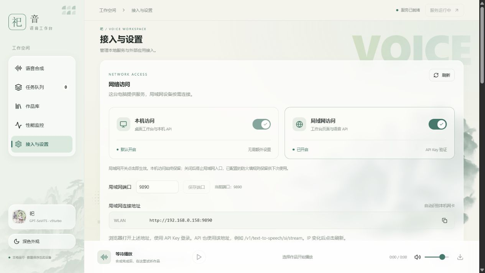

<div align="center">


# 祀音 · Siyin

**本地优先的 Windows 语音合成工作台**
在 gsv.cpp / GPT-SoVITS v5turbo 推理后端之上，提供文字与 TXT 合成、流式试听、任务队列、作品库、多格式导出、性能监控，以及 HTTP API 与 MCP 接入。

[](https://github.com/Arutoria2024/Siyin/releases)
[](LICENSE)
[](https://www.microsoft.com/windows)
[](https://www.python.org/)
[](app/ui)
[](https://github.com/Arutoria2024/Siyin/commits)

[功能特性](#-功能特性) · [下载安装](#-下载与安装) · [从源码构建](#-从源码构建) · [目录结构](#-目录结构) · [API 与 MCP](#-api-与-mcp) · [文档](#-文档) · [贡献](#-参与贡献)

</div>

---

## 📖 简介

**祀音（Siyin）** 是一套面向 Windows 的本地语音合成桌面应用。它在已有的 gsv.cpp / GPT-SoVITS 推理后端之上，补齐了一个完整的产品外壳：可视化工作台、串行任务队列、作品库、导出与监控，并同时对外暴露 **HTTP 语音网关** 与 **stdio MCP 服务**，方便其他应用与 AI Agent 直接驱动。

- **本地优先**：模型推理、合成与作品全部在本机完成，默认所有内部服务仅监听回环地址（127.0.0.1），数据不出机器。
- **默认音色 `si`（祀）**：GPT-SoVITS **v5turbo**，语速 `0.88`、采样步数 `4`、输出 24kHz 单声道（可选 48kHz）。

<div align="center">
  
  <p><sub>「接入与设置 · 网络访问」界面预览</sub></p>
</div>

## ✨ 功能特性

| | 能力 | 说明 |
|---|---|---|
| 🎙️ | **文本 / TXT 合成** | 单条或多文件 TXT 导入，长文按句段自动切分、顺序执行 |
| 🔊 | **流式试听** | 合成同时接收 PCM，边生成边听；完整作品保存为 WAV 母版 |
| 📚 | **作品库** | SQLite 管理任务状态、标题、来源与音色快照；支持搜索、回放、重试、导入转换 |
| 🎚️ | **多格式导出** | WAV / MP3 / FLAC / M4A(AAC) / Ogg(Opus) / 裸 PCM（实际取决于 FFmpeg 编码器） |
| 📈 | **性能监控** | GPU / CPU / 温度 / 显存 / 队列，负载曲线保留最近 15 分钟 |
| 🌐 | **HTTP 网关** | 本机 9881 网关；可选局域网入口（默认 9890），API Key 鉴权后共享工作台与 API |
| 🤖 | **MCP 接入** | 7 个 stdio 工具（状态/音色/合成/参数/参考音频/切换音色/预热），供 AI Agent 控制 |
| 🖥️ | **现代桌面 UI** | React 19 + TypeScript + Vite + WebView2，浅/深主题，水墨视觉 |
| 🔒 | **安全默认** | 独立密钥、每 IP 限流、HttpOnly 会话、防火墙仅放行本地子网 |

> 第一版不含语音识别、模型训练、云端托管或远程 HTTP MCP 服务。

## 📦 下载与安装

前往 [**Releases**](https://github.com/Arutoria2024/Siyin/releases) 下载最新版本。

安装器由**三个文件**组成（安装包 `*.exe` + 两个分卷 `*.bin`，总量约 2.9 GB），请**全部下载到同一目录**后再双击运行 exe；ZIP 分发请先完整解压。

**系统要求**：Windows 10/11 x64 · WebView2 Runtime · 支持 Vulkan 的显卡（建议显存 ≥ 6GB）· 约 4GB 安装空间。

> 首次加载模型约需 1～2 分钟。关闭窗口收进托盘；需要释放模型时用托盘菜单「停止服务并退出」。

## 🚀 从源码构建

> 仓库只含**源码与文档**，不含模型权重、Python/FFmpeg/引擎二进制。准备方式详见 [MODEL_AND_RUNTIME.md](MODEL_AND_RUNTIME.md)。

```powershell
# 1. 前端（app/ui）
cd app/ui
npm ci
npm run build          # 生成 app/ui/dist

# 2. 桌面与安装包（需要 Inno Setup 7，可用环境变量 SIYIN_ISCC 指定 ISCC.exe）
./packaging/build.ps1  # 前端构建 → C# 编译 Launcher → 单元测试 → 分卷安装包
```

本地开发时可用自备 Python 3.10 运行时启动 `app/desktop/launch.py`；生产由根目录 `祀音.exe` 启动。详见 [运维与源码发布](docs/运维与源码发布.md)。

## 🧱 目录结构

```text
祀音.exe（C# 启动器，由 app/desktop/Launcher.cs 编译）
  └─ app/desktop/launch.py（Python + pywebview + WebView2 + 托盘）
       └─ 127.0.0.1:9888（监控服务 + React 工作台 + 本地管理接口）
            ├─ SQLite、WAV 母版、任务串行派发
            └─ 9881 网关
                 └─ 127.0.0.1:9880（gsv.cpp / Vulkan 引擎）
                      └─ 127.0.0.1:9882（Python 文本处理 sidecar）
外部应用 ── API Key ──> 9881 网关
本机 Agent ── stdio MCP ──> 网关 / 引擎
```

| 路径 | 用途 |
|---|---|
| `app/ui/` | React + TypeScript + Vite 前端源码（`dist/` 为构建产物，不入库） |
| `app/desktop/` | 桌面启动器、托盘、SQLite 作品库、本地工作台接口、局域网入口 |
| `app/monitor/` | 本地服务监控与进程管理 |
| `app/services/` | 网关、任务调度、MCP 适配、合成核心 `core.py` |
| `app/frontend/` | GPT-SoVITS 文本前端（vendored，MIT）与 `text_sidecar.py` |
| `app/tests/` | 单元测试与集成验证脚本 |
| `packaging/` | Inno Setup 安装脚本、构建脚本与脱敏安装模板 |
| `docs/` | 运维、API / MCP 接入规范 |

## 🔌 API 与 MCP

- **HTTP 网关**：`POST /v1/text-to-speech/{voice}/stream`（流式 PCM/WAV），带 `Authorization: Bearer <KEY>`。
- **MCP**：7 个 stdio 工具，`tts_status / tts_list_voices / tts_speak / tts_set_params / tts_set_reference / tts_switch_voice / tts_warmup`。

接入细节见 [API 规范](docs/接入规范/API.md) 与 [MCP 规范](docs/接入规范/MCP.md)。密钥保存在 `app/services/config.json` 的 `gateway.token`，首次启动由 `bootstrap.py` 独立生成，**不会**写入前端资源。

## 📚 文档

- [模型与运行时准备](MODEL_AND_RUNTIME.md)
- [运维与源码发布](docs/运维与源码发布.md)
- [API 接入规范](docs/接入规范/API.md) · [MCP 接入规范](docs/接入规范/MCP.md) · [工具定义](docs/接入规范/mcp-tools.json)
- [第三方组件与素材归属](THIRD-PARTY-NOTICES.md)
- [更新日志](CHANGELOG.md)

## ❓ 常见问题

- **端口占用**：桌面默认回环端口 9888，被占用时自动避让到 9898 或空闲端口，实际端口见 `app/run/desktop-server.json`；网关固定 9881。
- **网关 401**：客户端 Key 与 `gateway.token` 不一致，或修改 Key 后未重启网关。
- **本机可用、局域网不通**：检查服务电脑 IP、TCP 与防火墙；局域网入口默认 9890，需在设置页开启。
- **导不出某格式**：确认 `app/tools/ffmpeg` 内 FFmpeg 编码器可用、磁盘空间充足、路径无异常。

## 🤝 参与贡献

欢迎提交 Issue 与 Pull Request！请先阅读 [贡献指南](CONTRIBUTING.md) 与 [行为准则](CODE_OF_CONDUCT.md)。安全相关问题请按 [SECURITY.md](SECURITY.md) 私下报告。

## 🙏 致谢

- gsv.cpp —— 高性能 C++ GPT-SoVITS 推理后端
- [GPT-SoVITS](https://github.com/RVC-Boss/GPT-SoVITS) —— 文本前端与模型方案（MIT）
- [pywebview](https://github.com/r0x0r/pywebview)、[pystray](https://github.com/moses-palmer/pystray)、[psutil](https://github.com/giampaolo/psutil)、[pythonnet](https://github.com/pythonnet/pythonnet)、[FFmpeg](https://ffmpeg.org/)

各组件的具体许可与素材归属见 [THIRD-PARTY-NOTICES.md](THIRD-PARTY-NOTICES.md)。

## 📄 License

本项目自有代码以 [MIT License](LICENSE) 发布。第三方代码、模型与素材的授权以其各自许可为准。

> **声明**：本项目为独立作品，与 gsv.cpp、GPT-SoVITS 等上游项目无隶属或背书关系。模型权重、参考音频、人物图片等素材的分发授权请单独核对，「代码开源」不等同于全部素材已获再分发授权。

---

<div align="center">

**如果这个项目对你有帮助，欢迎点一个 ⭐ Star！**

<a href="https://star-history.com/#Arutoria2024/Siyin&Date">
  
</a>

</div>
